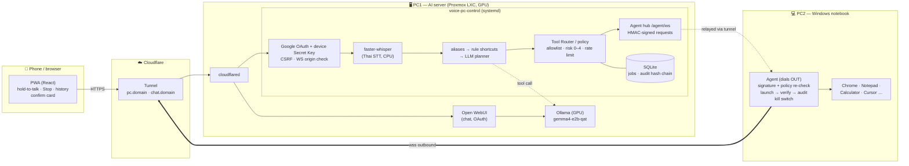
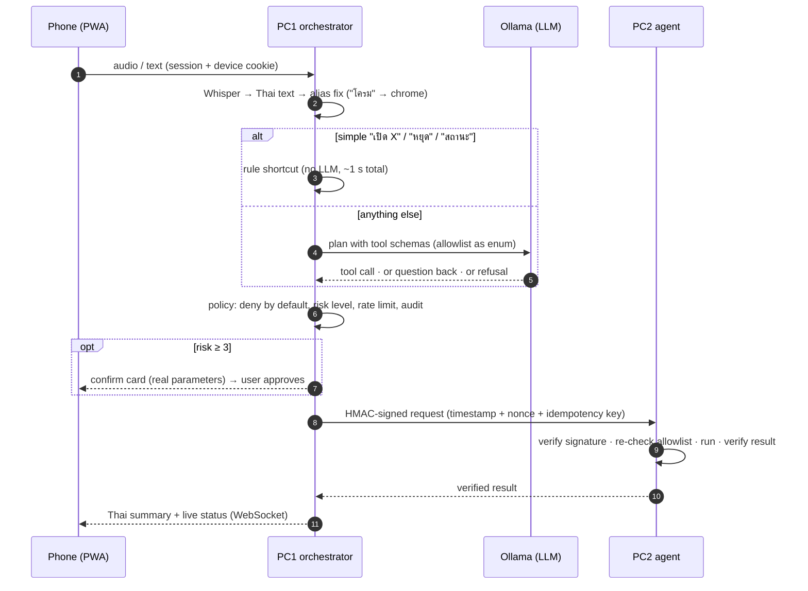

# Voice PC Control — ระบบสั่งงานคอมพิวเตอร์ด้วยเสียงผ่าน Local AI

Speak a command in Thai on your phone, and a **local AI on your own server** understands it, checks it
against safety rules, and makes your **Windows PC actually do it** — open apps and websites, report status,
stop instantly. No cloud AI: speech-to-text and the LLM run on your hardware.

> "เปิดโครมให้หน่อย" → Chrome opens on the notebook → phone shows "เปิด Chrome แล้ว" (≈1 s)
> "อยากจดอะไรหน่อย เปิดโปรแกรมจดบันทึกให้ที" → the LLM picks Notepad → opened and verified
> "ลบไฟล์ทั้งหมดในไดรฟ์ซี" → refused, nothing runs

Status: **Phase 1 (MVP) deployed** — see [CHECKLIST.md](CHECKLIST.md). Based on the design doc
`ระบบสั่งงานคอมพิวเตอร์ด้วยเสียง.pdf` (Design Draft v2). Install & operations: **[docs/DEPLOYMENT.md](docs/DEPLOYMENT.md)**.

---

## 1. Requirements

### Hardware
| Machine | Role | Minimum | Tested deployment | Notes |
|---|---|---|---|---|
| **PC1 — AI server** | Speech-to-text, LLM, safety policy, web app | 4 CPU cores, **8 GB RAM**, **NVIDIA GPU with 4 GB VRAM** (CUDA), 20 GB free disk | Proxmox LXC: 4 cores, 8 GB RAM, **GTX 1650 SUPER 4 GB** (GPU passthrough) | Runs 24/7. CPU-only works but LLM answers take several seconds instead of <1 s. 8 GB RAM is tight if the host runs other services — 16 GB recommended |
| **PC2 — controlled PC** | Runs the agent that launches apps | Windows 10 22H2 / 11, any CPU, 4 GB RAM | Windows 11 notebook | Must be **logged in** (UI automation needs the desktop). No inbound port, no VPN needed |
| **Phone / browser** | Remote control | Android Chrome or iOS Safari (last 2 versions), microphone | Android / desktop Chrome | Mic requires HTTPS (provided by the Cloudflare tunnel) |

Resource use on PC1 (measured): Ollama 1.2 GB RAM + **2.8 GB VRAM** (gemma4-e2b at 16k context), Open WebUI ~0.5 GB RAM,
orchestrator incl. Whisper `small` ~0.6 GB RAM. Models on disk: 4.3 GB (gemma4-e2b-qat) + 2.5 GB (qwen3-4b fallback).

### Which model for which GPU
| VRAM | LLM (Ollama) | Speech-to-text | Expected |
|---|---|---|---|
| CPU only | gemma4-e2b-qat (slow) | Whisper `small` int8 on CPU | works, LLM fallback several seconds |
| **4 GB** | **gemma4-e2b-qat** — 100 % GPU, p50 0.43 s (tested, [ADR-0002](docs/adr/0002-ollama-gemma4-e2b.md)) | Whisper `small` int8 on CPU | tested |
| 6–8 GB | Qwen3-4B-Instruct-2507 Q4 fully on GPU, or 7–8B models | Whisper `medium` on GPU | better Thai accuracy |
| 12 GB+ | 8–14B models (needed for Phase 3 coding agent) | Whisper large / Thai fine-tunes | — |

Always confirm with the benchmark: `python eval/run.py --llm ollama --model <name>` (30 Thai golden commands).

### Software & accounts
| Where | Needs |
|---|---|
| PC1 | Linux (Ubuntu 24.04 tested; Proxmox LXC/VM fine), Docker + Compose + NVIDIA Container Toolkit, Python 3.12, `cloudflared` |
| PC2 | Python 3.11+, Git, `keyring` (secret stored in Windows Credential Manager) |
| Dev machine | Python 3.12, Node.js 22 (to build the PWA) |
| Accounts | A domain on **Cloudflare** (tunnel), a **Google Cloud OAuth client** (login). Optional: GitHub OAuth app (Open WebUI) |

---

## 2. Architecture



### What happens for one command


### Security model (layers)
1. **Network** — nothing listens on the internet directly: Cloudflare tunnel only; Ollama and Open WebUI bind to `127.0.0.1`; PC2 opens no port.
2. **Who** — Google login limited to allow-listed emails **and** a device paired once with a Secret Key (revocable); HttpOnly cookies, CSRF header, WebSocket origin check.
3. **What** — the LLM is treated as untrusted: tool schemas with enums, deny-by-default router, risk levels, confirm card for risky tools, loop/rate limits.
4. **PC2 checks again** — every request HMAC-verified (replay-proof), allowlist re-checked, result verified, never `shell=True`.
5. **Accountability** — hash-chained audit logs on PC1 and PC2; Stop button and an offline kill switch.

Details: [security/THREAT_MODEL.md](security/THREAT_MODEL.md), [ADR-0003](docs/adr/0003-public-web-access.md).

---

## 3. What it can do (Phase 1)

| Works now | Refused by design | Later phases |
|---|---|---|
| Open allow-listed apps (Chrome, Notepad, Calculator, Explorer, Cursor) | Apps/sites not on the allowlist (e.g. `regedit`) | Phase 2: web search & reading, files/Office, confirm + taint for risky actions |
| Open allow-listed websites (YouTube, Google, GitHub…) | Deleting files, shell commands, payments | Phase 3: AI coding agent on git branches, run tests, diff/revert |
| Status of PC2, Stop everything | Anything ambiguous → asks back instead of guessing | Phase 4: wake word, voice replies (TTS), Wake-on-LAN |
| Understands intent ("อยากจดอะไร" → Notepad) via the LLM | | |

Measured: rule shortcuts ≈1 s end-to-end; LLM planning p50 0.46 s (p95 2.5 s) on the GTX 1650 SUPER;
golden set: tool accuracy 100 %, dangerous commands executed 0, clarification 75 %.

---

## 4. Repository layout
| Path | What |
|------|------|
| `contracts/` | Tool schemas, risk levels, HMAC signing — shared by PC1 and PC2 |
| `pc1-orchestrator/app/core` | Domain: Job state machine, aliases, shortcuts, policy, use cases (no framework imports) |
| `pc1-orchestrator/app/ports`, `adapters` | Interfaces + adapters (faster-whisper, Ollama, OpenAI-compatible, PC2 HTTP/relay, SQLite) and fakes |
| `pc1-orchestrator/app/api` | FastAPI REST + WebSocket, Google login + device pairing (`webauth.py`), `/agent/ws` |
| `pc2-agent/agent` | Agent API, policy, tool plugins, audit, kill switch, outbound connector |
| `mobile-pwa/` | React + TypeScript PWA |
| `eval/` | Golden dataset + benchmark harness (tool accuracy, refusal, clarify, CER, latency) |
| `docker-compose.yml` | Ollama + Open WebUI (+ optional orchestrator container) |
| `infra/pc1/`, `infra/cloudflared/` | systemd unit, env example, `deploy.sh`, `vpc-cli`, tunnel ingress example |
| `docs/`, `security/` | Deployment guide, ADRs, threat model |

---

## 5. Getting started

### Production install
Follow **[docs/DEPLOYMENT.md](docs/DEPLOYMENT.md)**: Ollama + Open WebUI → orchestrator service → Cloudflare tunnel
→ Google OAuth → PC2 agent → pair your phone. It also covers updates, `vpc-cli`, troubleshooting and rollback.

### Local development (fake STT / LLM / PC2)
```powershell
python -m venv .venv; .venv\Scripts\pip install -r requirements-dev.txt pytest-timeout
.venv\Scripts\python -m pytest -q                      # 158 tests
cd mobile-pwa; npm ci; npm run build; cd ..
$env:PYTHONPATH="contracts;pc1-orchestrator"
$env:VPC_PUBLIC_URL="http://localhost:8000"; $env:VPC_SESSION_SECRET="dev-" + ("x" * 40)
$env:VPC_GOOGLE_CLIENT_ID="..."; $env:VPC_GOOGLE_CLIENT_SECRET="..."; $env:VPC_ALLOWED_EMAILS="you@gmail.com"
.venv\Scripts\python -m app.cli set-pairing-key       # Secret Key for the pairing screen
.venv\Scripts\python -m uvicorn app.main:build --factory --app-dir pc1-orchestrator --port 8000
# open http://localhost:8000 → Google → Secret Key → type "เปิดโน้ตแพด"
```
The Google client needs `http://localhost:8000/auth/google/callback` as a redirect URI for local testing.
Switch real components with env vars (`pc1-orchestrator/app/settings.py`), e.g. `VPC_STT=faster_whisper`,
`VPC_LLM=ollama VPC_OLLAMA_MODEL=gemma4-e2b-qat`, `VPC_PC2=relay VPC_PC2_SECRET=...`.
API-only testing without a browser: leave `VPC_PUBLIC_URL` unset and use `python -m app.cli add-device` bearer tokens.

### Choosing a model for your GPU
```bash
docker exec ollama ollama pull hf.co/<repo>:<quant>
python eval/run.py --set dev --llm ollama --model hf.co/<repo>:<quant>
```
Pick the fastest model with tool accuracy ≥ 90 % and 0 dangerous commands executed; record it as an ADR.

Emergency stop on PC2 without the network: `python -m agent.killswitch on`.
